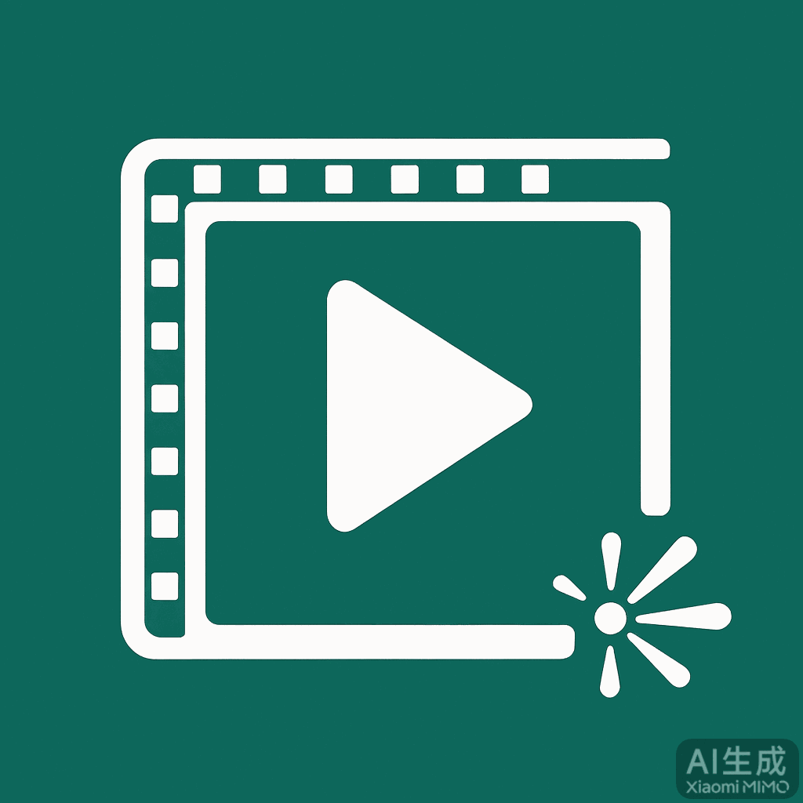

<div align="center">



# 🎬 AI 视频工作台

**AI Video Workbench** — 让完全不会用 AI 的人，也能三步做出一条视频

网页 · Windows 桌面 · 安卓 App，三端同一套界面

  

</div>

---

## 这是什么

一句话：**选模型 → 写一句话 → 点生成 → 下载**，剩下交给 AI。

本项目专为**完全没有接触过 AI 视频生成的小白用户**设计：不用命令行、不用写代码、不用懂 API 参数。只要你有一家支持视频生成的 AI 服务商账号（拿到 Base URL 和 API Key），就能在自己的电脑或手机上傻瓜式做视频。

> 📌 **当前为基础版**：只包含「配置接口 → 生成视频 → 下载保存」这条最基本的主流程，功能还很简单。后续需要继续开发才能逐步完善（见下方[路线图](#路线图)），欢迎一起参与。

## 功能特性

- **图生视频 / 文生视频**：图生必须有参考图，文生只写提示词，界面会自动区分
- **多接口管理**：可同时保存多套接口（Base URL + API Key），每套接口拥有自己独立的模型列表，互不干扰
- **演示模式**：不调真实接口、不扣一分钱，先用演示参数把流程练熟
- **费用预估 + 扣费二次确认**：生成前明确显示预估费用，点确认才真正扣费
- **任务记录 + 一键下载**：生成历史不丢失，视频自动保存到你指定的文件夹
- **数据备份**：配置支持导出 / 导入 JSON，换设备不丢配置
- **字体大小调节**：85%–130% 无级缩放，长辈也能看清
- **三端同源**：同一份界面跑在浏览器、Windows（pywebview）、安卓（Capacitor）

## 界面预览

> 截图待补充：欢迎使用者截图后提交 Pull Request（新建 `docs/` 目录放入即可）。

## 快速开始

### 方式一：网页版（最简单，先体验）

1. 下载本仓库（Code → Download ZIP 并解压，或 `git clone`）
2. 双击打开 `index.html`（若切换页面无效，按 **Ctrl+F5** 强制刷新）
3. 按下方「使用步骤」配置你自己的接口

> 网页版用浏览器存储保存配置，下载视频走浏览器行为；**完整体验（自动下载到指定文件夹）推荐桌面版**。

### 方式二：Windows 桌面版

```bash
# 1. 安装 Python 3.10+（勾选 Add to PATH）
# 2. 安装依赖
python -m pip install pywebview
# 3. 运行
cd desktop
开发启动.bat        # 或直接：python main.py
```

想打包成免安装 exe？见 [`desktop/构建说明.md`](desktop/构建说明.md)。

### 方式三：安卓 App

见 [`android/构建说明.md`](android/构建说明.md)（需要 Node.js + Android 开发环境），或到本仓库 **Releases** 页下载已打包的 APK 直接安装。

## 使用步骤（三步做出第一条视频）

1. **添加接口**：打开「设置 → 添加接口」，填入接口名称、Base URL 和 API Key（这些信息在你购买 AI 视频服务的服务商控制台获取）
2. **添加模型**：在该接口下点「添加模型」，模型 ID 与服务商提供的模型名**完全一致**，选好图生/文生、清晰度单价、时长范围
3. **生成**：回到生成页，选接口和模型 → 写提示词（图生选一张参考图）→ 点「生成视频」→ 成功后点「下载视频」

> ⚠️ **新手务必先开「演示模式」**练手（生成按钮下方）；用真实 Key 生成会按秒扣费，界面有二次确认，但也请珍惜钱包。

## 常见问题

| 问题 | 说明 |
|------|------|
| 支持哪些服务商？ | 任何兼容 `POST /v1/video/generations` 视频接口的服务商都可自行配置 |
| 视频会一直保存吗？ | 不会。任务列表只存记录和链接，视频文件在服务商侧约 24 小时后可能删除，**请及时下载** |
| 我的 Key 安全吗？ | Key 只保存在你自己设备的本地存储中，本项目不联网上传任何数据；请勿把含配置的备份 JSON 发给别人 |
| 换电脑/手机怎么迁移？ | 设置 → 数据备份 → 导出 JSON，在新设备导入 |

## 项目结构

```
├── index.html          # 界面源码（单文件，三端共用，无构建步骤）
├── assets/             # 图标
├── desktop/            # Windows 桌面端（Python + pywebview）
│   ├── main.py         # 桌面壳：窗口、文件下载、目录选择、配置落盘
│   └── 构建说明.md      # 如何打包成免安装 exe
└── android/            # 安卓端（Capacitor 壳）
    ├── www/            # 网页资产（同步自 index.html）
    ├── android/        # Android 工程（Gradle）
    └── 构建说明.md      # 如何打包 APK
```

## 路线图

当前是基础版，以下为后续开发方向（欢迎认领）：

- [x] 图生 / 文生视频基本流程
- [x] 多接口 + 独立模型管理
- [x] 演示模式、费用确认、任务记录、一键下载、备份
- [ ] 适配更多服务商的返回格式（不同轮询字段）
- [ ] 批量生成 / 任务队列
- [ ] 本地视频库（已下载视频管理、重命名、分类）
- [ ] 提示词模板 / 灵感库
- [ ] 多语言界面（i18n）
- [ ] 桌面端自动检查更新

## 参与开发

欢迎继续开发完善本项目：

- 网页端是**单个 `index.html`**，无任何构建步骤，改完刷新即生效，上手成本极低
- 桌面端 `desktop/main.py`（Python + pywebview），安卓端 `android/`（Capacitor）
- 流程：Fork 本仓库 → 修改 → 提交 Pull Request；问题与建议请开 Issue
- 请遵守本项目[许可证](#许可证)：允许继续开发与分发，**禁止商用**，衍生作品需以相同协议共享并署名

## 免责声明（必读）

1. 本项目**免费开源、按「现状」提供**——意思是：软件现在是什么样，就拿什么样用；作者不承诺修复所有问题，也不承诺功能永久可用。**仅供学习、研究与个人非商业用途**，不构成任何服务承诺。
2. 使用本项目需**自备** AI 视频服务商的 API Key，由此产生的一切费用由使用者自行承担；请勿反复无意义地真实生成。
3. **生成内容的合法性、版权与使用后果由使用者自行负责**。严禁将本项目用于违法违规、侵犯他人权益、深度伪造 / 冒充他人、骚扰欺诈等用途，请遵守所在地区法律法规与服务平台条款。
4. 视频文件存储于第三方服务商，约 24 小时后可能被删除，重要内容请及时下载到本地。
5. 本项目为基础版，不保证功能完整、接口兼容与服务连续性；开发者不对接口扣费、数据丢失、视频删除或任何间接损失承担责任。

## 许可证

本项目采用 **[CC BY-NC-SA 4.0](https://creativecommons.org/licenses/by-nc-sa/4.0/deed.zh)**（署名—非商业性使用—相同方式共享 4.0）协议发布：

- ✅ **允许**：个人学习使用、修改、继续开发、二次分发（需署名，并以相同协议共享）
- ❌ **禁止**：任何形式的**商业使用**（包括但不限于收费售卖、付费分发、集成进商业产品或商业服务）

完整条款见 [LICENSE](LICENSE)。

---

<div align="center">

**设计者：JYJL** · 如果这个工具帮到了你，欢迎点一个 ⭐ Star

</div>
